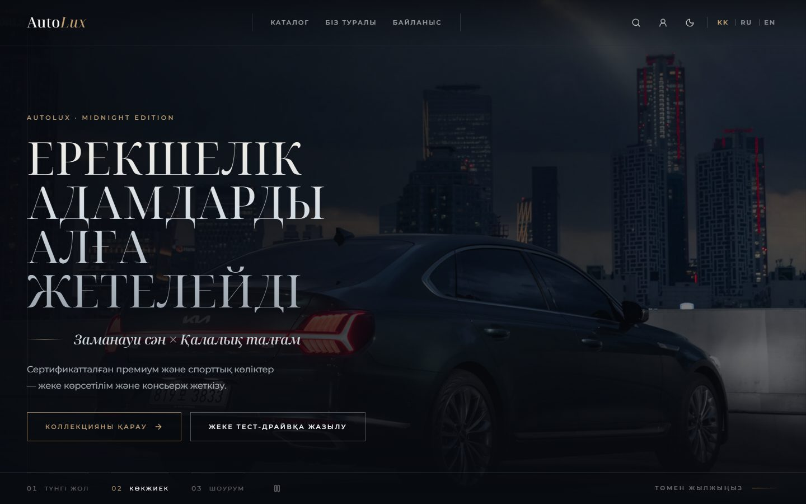
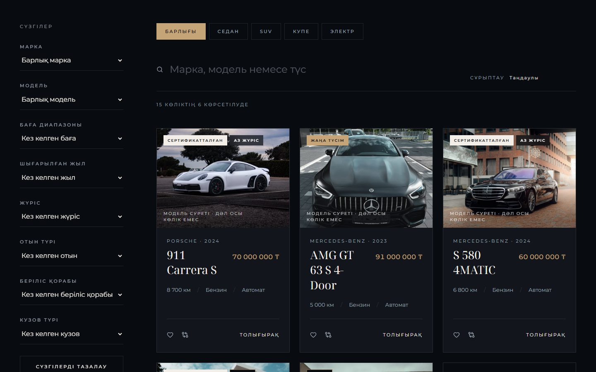
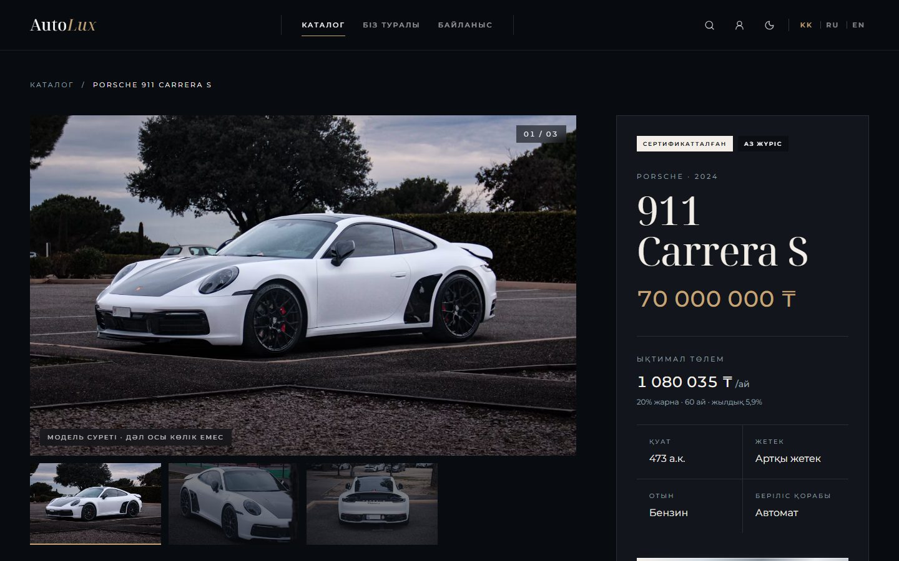
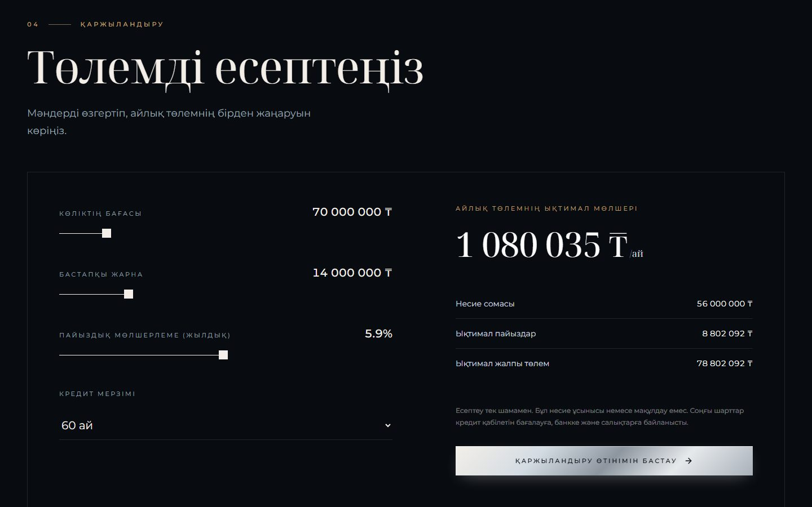
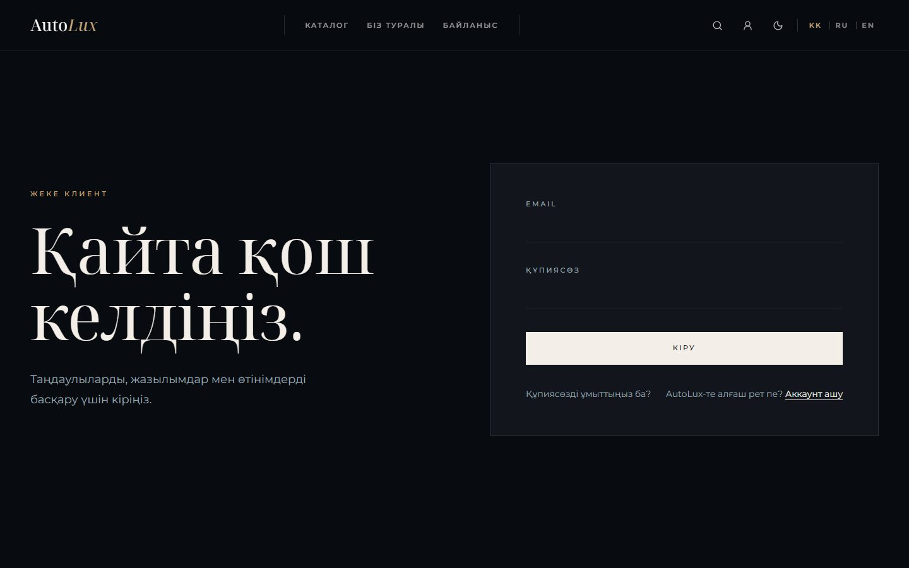
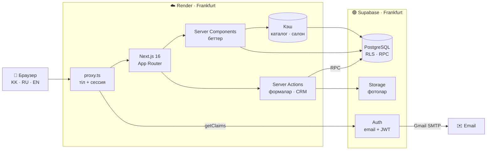
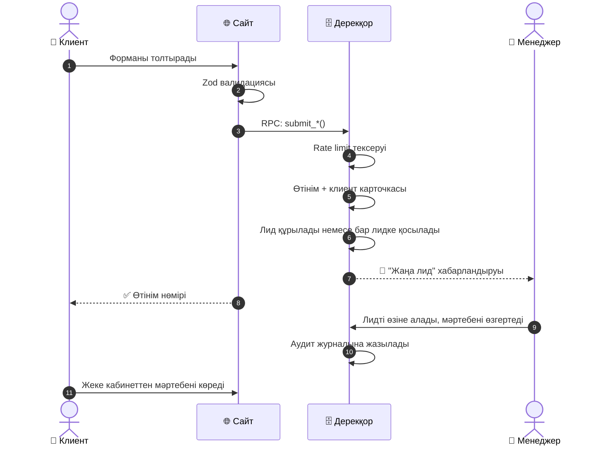
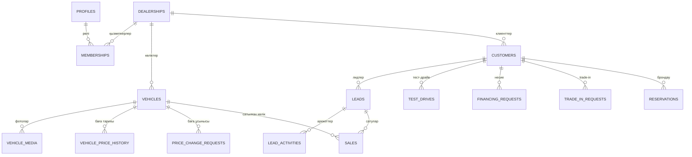
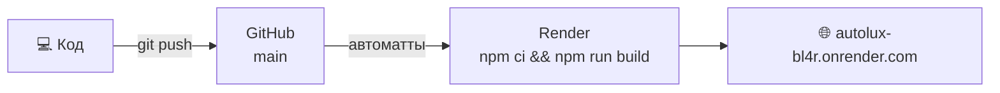

<div align="center">



# Auto*Lux*

### Премиум автосалонға арналған толық веб-платформа

**Клиенттерге арналған сайт · CRM · Басқару панелі · Аналитика** — бәрі бір жерде

<br />

<a href="https://autolux-bl4r.onrender.com"></a>

<br /><br />


🇰🇿 Қазақша &nbsp;·&nbsp; 🇷🇺 Русский &nbsp;·&nbsp; 🇬🇧 English

</div>

---

## 📑 Мазмұны

- [Жоба туралы](#-жоба-туралы)
- [Скриншоттар](#-скриншоттар)
- [Клиентке арналған мүмкіндіктер](#-клиентке-арналған-мүмкіндіктер)
- [Басқару панелі](#️-басқару-панелі)
- [Рөлдер мен рұқсаттар](#-рөлдер-мен-рұқсаттар)
- [Архитектура](#️-архитектура)
- [Өтінім қалай өңделеді](#-өтінім-қалай-өңделеді)
- [Дерекқор](#️-дерекқор)
- [Қауіпсіздік](#-қауіпсіздік)
- [Жылдамдық](#-жылдамдық)
- [Технологиялар](#-технологиялар)
- [Жоба құрылымы](#-жоба-құрылымы)
- [Жергілікті іске қосу](#-жергілікті-іске-қосу)
- [Тесттер](#-тесттер)
- [Деплой](#️-деплой)

---

## 💎 Жоба туралы

**AutoLux** — автосалонның бүкіл жұмысын бір жерге жинайтын веб-платформа. Ол үш адамға арналған:

<table>
<tr>
<td width="33%" valign="top">

### 🧑‍💼 Клиент
Көліктерді қарайды, салыстырады, несиені есептейді, тест-драйвқа жазылады және барлық өтінімін жеке кабинетте бақылайды.

</td>
<td width="33%" valign="top">

### 👔 Менеджер
Өтінімдерді қабылдайды, клиенттермен жұмыс істейді, тапсырмалар орындайды, сатуды тіркейді.

</td>
<td width="33%" valign="top">

### 👑 Салон иесі
Аналитиканы көреді, команданы басқарады, бағаларды бекітеді, әрбір әрекетті аудит журналынан бақылайды.

</td>
</tr>
</table>

**Дизайны — "Midnight Edition":** қараңғы премиум эстетика, серифті үлкен типографика, алтын түсті акценттер, жұмсақ анимациялар. Жарық тақырыпқа бір басумен ауысады.

> **English summary:** AutoLux is a production-grade, trilingual (KK / RU / EN) dealership platform — a premium storefront plus a role-based CRM and admin dashboard. Built with Next.js 16, React 19 and Supabase (Postgres, Auth, Storage) with Row Level Security on every table, 7 staff roles, an audit log, and 63 automated tests including database-level security tests.

---

## 📸 Скриншоттар

<table>
<tr>
<td width="50%">

<p align="center"><b>Каталог</b> — сүзгілер, іздеу, сұрыптау</p>
</td>
<td width="50%">

<p align="center"><b>Көлік беті</b> — галерея, баға, айлық төлем</p>
</td>
</tr>
<tr>
<td width="50%">

<p align="center"><b>Несие калькуляторы</b> — көліктің бағасымен бірден есептейді</p>
</td>
<td width="50%">

<p align="center"><b>Жеке кабинет</b> — кіру және тіркелу</p>
</td>
</tr>
</table>

---

## ✨ Клиентке арналған мүмкіндіктер

| | Мүмкіндік | Сипаттамасы |
|:-:|---|---|
| 🏠 | **Басты бет** | Толық экранды hero, таңдаулы көліктер және кузов түрлері бойынша бөлімдер (Седан, Купе, SUV...) фотосуреттерімен |
| 🚗 | **Каталог** | Маркасы, моделі, бағасы, жылы, жүрісі, отын түрі, беріліс қорабы және кузов түрі бойынша сүзгілер, іздеу және сұрыптау |
| 📄 | **Көлік беті** | Фото галерея, техникалық сипаттамалар, негізгі опциялар, ұқсас көліктер |
| 💳 | **Несие** | Калькулятор әр көліктің өз бағасымен есептейді, несие өтінімін сол беттен жіберуге болады |
| ⚖️ | **Салыстыру** | Бірнеше көлікті қатар қойып, сипаттамаларын салыстыру |
| ❤️ | **Таңдаулылар** | Ұнаған көліктерді жеке кабинетке сақтау |
| 🗓️ | **Тест-драйв** | Бос уақытты таңдап, онлайн жазылу |
| 🔧 | **Сервис** | Техникалық қызмет көрсетуге жазылу |
| 🔁 | **Trade-in** | Ескі көлікті бағалауға өтінім жіберу |
| 🔖 | **Брондау** | Көлікті алдын ала брондау |
| 👤 | **Жеке кабинет** | Барлық өтінімнің мәртебесі, профильді өңдеу, өтінімнен бас тарту |
| ✉️ | **Email** | Тіркелуді растау және құпия сөзді қалпына келтіру (өз Gmail SMTP арқылы) |
| 🌐 | **3 тіл** | Қазақша (негізгі), орысша, ағылшынша, әр тілдің өз URL-і бар (`/kk`, `/ru`, `/en`) |
| 🌗 | **Тақырып** | Қараңғы және жарық режим, таңдау сақталып қалады |
| 📱 | **Адаптивті** | Телефонда, планшетте және компьютерде дұрыс көрінеді |

---

## 🛠️ Басқару панелі

`/admin` — салон қызметкерлеріне арналған жеке панель. Әр қызметкер тек өз рөліне рұқсат етілген бөлімдерді көреді.

<table>
<tr><th>Топ</th><th>Бөлім</th><th>Не істейді</th></tr>
<tr><td rowspan="3"><b>Жұмыс орны</b></td><td>📊 Шолу</td><td>Негізгі көрсеткіштер мен соңғы әрекеттер</td></tr>
<tr><td>✅ Тапсырмалар</td><td>Қызметкерлерге тапсырма беру, тағайындалғанда хабарландыру жіберу</td></tr>
<tr><td>🔔 Хабарландырулар</td><td>Жаңа лидтер, тапсырмалар және өзгерістер</td></tr>
<tr><td rowspan="2"><b>Қойма</b></td><td>🚘 Көліктер</td><td>Көлік қосу және өңдеу, фото жүктеу, жариялау немесе жасыру</td></tr>
<tr><td>💲 Бағалар</td><td>Баға өзгерісі бекітуден өтеді, бағаның бүкіл тарихы сақталады</td></tr>
<tr><td rowspan="3"><b>Сату</b></td><td>🎯 Лидтер (CRM)</td><td>Клиент өтінімдері, менеджерге бөлу, мәртебе, әрекеттер тарихы</td></tr>
<tr><td>👥 Клиенттер</td><td>Клиенттер базасы және әр клиенттің тарихы</td></tr>
<tr><td>🧾 Сатулар</td><td>Сату аяқталғанда көлік автоматты түрде "сатылды" болады, сату жойылса қайтадан сатылымға шығады</td></tr>
<tr><td rowspan="4"><b>Жазылулар</b></td><td>📅 Күнтізбе</td><td>Барлық тест-драйв пен сервис бір күнтізбеде</td></tr>
<tr><td>🏁 Тест-драйвтар</td><td>Растау, ауыстыру, аяқтау</td></tr>
<tr><td>🔖 Брондаулар</td><td>Брондалған көлік автоматты түрде "брондалды" мәртебесіне өтеді</td></tr>
<tr><td>🔧 Сервис</td><td>Сервиске жазылуларды өңдеу</td></tr>
<tr><td rowspan="3"><b>Өтінімдер</b></td><td>💬 Сұраулар</td><td>Байланыс формасынан келген хабарламалар</td></tr>
<tr><td>💳 Несие</td><td>Несие өтінімдері</td></tr>
<tr><td>🔁 Trade-in</td><td>Көлікті бағалау өтінімдері</td></tr>
<tr><td rowspan="4"><b>Басқару</b></td><td>📈 Аналитика</td><td>Сату, лидтер және конверсия</td></tr>
<tr><td>🧑‍🤝‍🧑 Команда</td><td>Қызметкерлерді сілтеме арқылы шақыру, рөл беру және өзгерту</td></tr>
<tr><td>🛡️ Аудит</td><td>Барлық маңызды әрекеттердің журналы: кім, не істеді, қашан</td></tr>
<tr><td>⚙️ Баптаулар</td><td>Салон туралы ақпарат, жұмыс уақыты, логотип, жазылу уақыттары</td></tr>
</table>

---

## 👥 Рөлдер мен рұқсаттар

Платформада **7 қызметкер рөлі** бар. Рұқсаттар дерекқорда сақталады, сондықтан әр салон оларды өзіне қарай баптай алады.

| Рөл | Кім | Негізгі құқықтары |
|---|---|---|
| 👑 `owner` | Салон иесі | Барлығы, оның ішінде команда мен баптаулар |
| 🎩 `general_manager` | Бас менеджер | Бүкіл салонның жұмысы, аналитика |
| 📋 `sales_manager` | Сату бөлімінің басшысы | Барлық лид, лидтерді бөлу, сатулар |
| 🤝 `sales_rep` | Сатушы | **Тек өзіне бөлінген** лидтер мен клиенттер |
| 📦 `inventory_manager` | Қойма менеджері | Көліктер, фото, баға ұсыныстары |
| 💰 `finance_manager` | Несие менеджері | Несие өтінімдері |
| 📞 `receptionist` | Ресепшн | Жазылулар мен сұраулар |

Тіркелген әрбір пайдаланушы алдымен **клиент** болады. Қызметкер болу үшін салон иесі шақыру сілтемесін жібереді.

---

## 🏗️ Архитектура



**Негізгі шешімдер:**
- **Сервер компоненттері** деректерді серверде оқиды, браузерге тек дайын HTML мен аз ғана JavaScript жіберіледі.
- **Server Actions** барлық форманы өңдейді: деректер Zod арқылы тексеріліп, дерекқорға RPC арқылы жазылады.
- **Барлық бизнес-логика дерекқорда:** мәртебе ауысулары, рұқсат тексерулері, аудит. Біреу API-ге тікелей сұрау жіберсе де, ережелерді айналып өте алмайды.

---

## 🔄 Өтінім қалай өңделеді

Клиент кез келген форманы жібергенде (тест-драйв, несие, trade-in, сұрау...) мынадай тізбек орындалады:



---

## 🗄️ Дерекқор

**31 кесте · 52 RLS саясаты · 6 миграция**



| Миграция | Мазмұны |
|---|---|
| `foundation` | Салондар, профильдер, рөлдер, рұқсаттар, аудит, хабарландырулар, rate limit |
| `inventory` | Көліктер, фото, жабдықтар, баға тарихы, баға бекіту |
| `crm` | Клиенттер, лидтер, әрекеттер, тапсырмалар, сатулар |
| `requests` | Сұраулар, тест-драйв, брондау, несие, trade-in, сервис |
| `team_analytics` | Шақырулар, аналитика, функция құқықтары |
| `storage` | Фото мен логотипке арналған бакеттер және олардың саясаттары |

---

## 🔒 Қауіпсіздік

Қауіпсіздік тек интерфейсте емес, **дерекқордың өзінде** қамтамасыз етілген.

| | Қорғаныс | Қалай жұмыс істейді |
|:-:|---|---|
| 🛡️ | **Row Level Security** | Барлық кестеде қосулы: әр пайдаланушы тек өзіне рұқсат етілген жолдарды көреді |
| 🏢 | **Салондарды бөлу** | Composite foreign key бір салонның деректерін екінші салонмен байланыстыруға мүмкіндік бермейді |
| 🔐 | **Қорғалған операциялар** | Сату, баға бекіту, рөл беру тек тексерілген `SECURITY DEFINER` функциялары арқылы орындалады, кестелерге тікелей жазу бұғатталған |
| 🔢 | **Optimistic locking** | `version` бағаны екі адамның бір жазбаны бір уақытта өзгертіп, бірінің жұмысын байқамай өшіріп тастауынан қорғайды |
| 🚦 | **Rate limiting** | Формаларды спаммен толтырудан қорғайды |
| 🔑 | **Құпия кілттер** | Қолданба тек public кілтті пайдаланады, service-role кілті берілсе іске қосылмайды |
| 📦 | **Bundle тексеруі** | Тест браузерге жіберілетін JavaScript ішінде құпия кілт жоқ екенін тексереді |
| ✅ | **Валидация** | Барлық кіріс деректері серверде Zod арқылы тексеріледі |
| 📝 | **Аудит** | Маңызды әрекеттер мен рұқсатсыз әрекет жасау талпыныстары журналға жазылады |
| ✉️ | **Email** | Растау сілтемелері `token_hash` арқылы жұмыс істейді, сондықтан басқа құрылғыда ашса да дұрыс істейді |

---

## ⚡ Жылдамдық

- **Кэш:** каталог пен салон туралы ақпарат серверде кэштеледі. Админ өзгеріс енгізгенде кэш бірден жаңарады.
- **SSG + ISR:** көлік беттері алдын ала құрастырылып, әр 5 минут сайын жаңарады.
- **JWT тексеруі:** сессия жергілікті тексеріледі, әр бет ауысқанда Auth серверіне артық сұрау жіберілмейді.
- **Жүктелу индикаторы:** басқан сәтте жоғарыда жүктелу сызығы мен беттің қаңқасы бірден көрінеді.
- **Параллель сұраулар:** бір беттегі барлық деректер бір уақытта жүктеледі.

---

## 🧰 Технологиялар

| Қабат | Технология |
|---|---|
| **Framework** | Next.js 16 (App Router, Turbopack, Server Actions) |
| **UI** | React 19, Tailwind CSS 4, Motion, Lucide Icons |
| **Тіл** | TypeScript (strict) |
| **Аударма** | next-intl 4 |
| **Backend** | Supabase: PostgreSQL, Auth, Storage, RLS, RPC |
| **Валидация** | Zod 4 |
| **Тесттер** | Vitest, PGlite (Docker-сіз нақты Postgres) |
| **Email** | Gmail SMTP |
| **Хостинг** | Render (Frankfurt), GitHub-тан автоматты деплой |

---

## 📁 Жоба құрылымы

```
AutoLux/
├── src/
│   ├── app/
│   │   ├── [locale]/
│   │   │   ├── (site)/            # Клиенттік беттер: каталог, көлік, кабинет...
│   │   │   └── admin/             # Басқару панелі (17 бөлім)
│   │   └── api/auth/confirm/      # Email сілтемелерін растау
│   ├── components/                # UI компоненттері
│   ├── lib/
│   │   ├── actions/               # Server Actions: формалар, CRM, қойма, команда
│   │   ├── data/                  # Деректерді оқу және кэштеу
│   │   ├── auth/                  # Сессия, рөлдер, рұқсаттар
│   │   └── supabase/              # Supabase клиенттері және конфигурация
│   └── proxy.ts                   # Тіл маршрутизациясы және сессияны жаңарту
├── supabase/
│   ├── migrations/                # 6 SQL миграция
│   └── seed.sql                   # Бастапқы деректер (салон + 15 көлік)
├── messages/                      # kk.json · ru.json · en.json
├── tests/
│   ├── unit/                      # Логика, форматтау, аударма
│   ├── db/                        # Дерекқор, RLS, қауіпсіздік (PGlite)
│   └── build/                     # Bundle-де құпия кілттің жоқтығы
├── docs/                          # Supabase нұсқаулығы, скриншоттар
└── render.yaml                    # Render blueprint
```

---

## 🚀 Жергілікті іске қосу

**Талаптар:** Node.js 20.9+ және npm.

```bash
git clone https://github.com/Sailauov08/AutoLux.git
cd AutoLux
npm install
cp .env.example .env.local
npm run dev
```

Сайт **http://localhost:3000** адресінде ашылады.

> 💡 Supabase қосылмаса, сайт **демо режимде** үлгі көліктермен жұмыс істейді. Мұндай режимде формалар жіберілмейді, админ панель де ашылмайды.

### Supabase-ті қосу

1. [supabase.com](https://supabase.com) сайтында жоба ашыңыз (Frankfurt аймағы ұсынылады).
2. `npm run db:bundle` командасы барлық миграция мен seed-ті бір `supabase/setup.sql` файлына жинайды. Сол файлды SQL Editor-да бір рет іске қосыңыз.
3. `.env.local` файлына URL мен **publishable** кілтті енгізіңіз.

Толық нұсқаулық: **[docs/SUPABASE_SETUP.md](docs/SUPABASE_SETUP.md)**

### Айнымалылар

| Айнымалы | Сипаттамасы |
|---|---|
| `NEXT_PUBLIC_SUPABASE_URL` | Supabase жобасының URL |
| `NEXT_PUBLIC_SUPABASE_PUBLISHABLE_KEY` | Publishable кілт (`sb_publishable_…`), ол құпия емес |
| `NEXT_PUBLIC_DEALERSHIP_SLUG` | Салонның идентификаторы: `autolux` |
| `NEXT_PUBLIC_SITE_URL` | Сайттың ашық адресі, email сілтемелері үшін керек |

> ⚠️ Service-role немесе secret кілтті ешқашан қоспаңыз. Қолданбаға ол кілт керек емес, берілсе қолданба іске қосылмайды.

### Командалар

| Команда | Не істейді |
|---|---|
| `npm run dev` | Әзірлеу сервері |
| `npm run build` | Production build |
| `npm start` | Production серверді іске қосу |
| `npm run typecheck` | TypeScript тексеруі |
| `npm run lint` | ESLint |
| `npm test` | Барлық тест |
| `npm run db:bundle` | `supabase/setup.sql` файлын жинау |
| `npm run db:seed` | Seed файлын қайта генерациялау |

---

## ✅ Тесттер

```bash
npm test
```

**63 тест**, Docker-сіз. Дерекқор тесттері нақты PostgreSQL-ді процесс ішінде іске қосатын [PGlite](https://pglite.dev) арқылы өтеді.

| Топ | Не тексеріледі |
|---|---|
| 🗄️ **Дерекқор** | Миграциялар қатесіз орындалады, seed дұрыс жүктеледі, бизнес-процестер (лид → сату → көлік мәртебесі) дұрыс жұмыс істейді |
| 🔐 **Рұқсаттар** | Әр рөл тек өзіне рұқсат етілгенді көреді және өзгертеді |
| 🛡️ **Қауіпсіздік** | Бір салон екінші салонның деректерін көре алмайды, клиент персонал функцияларын шақыра алмайды, ішкі функциялар сырттан ашық емес |
| ⚙️ **Server Actions** | Қате деректер қабылданбайды, backend қосылмаса әрекет сәтті болды деп көрсетілмейді |
| 🌐 **Аударма** | Үш тілдегі кілттер толық сәйкес келеді |
| 📦 **Build** | Браузерге жіберілетін JavaScript ішінде құпия кілт жоқ |

---

## ☁️ Деплой

Сайт **[Render](https://render.com)** платформасында [`render.yaml`](render.yaml) blueprint арқылы орналастырылған.



`main` тармағына жасалған әр push сайтты автоматты түрде жаңартады.

> ℹ️ Render-дің тегін тарифінде сайтқа 15 минут ешкім кірмесе, сервер "ұйықтап" қалады. Сондықтан келесі алғашқы ашылу 30–50 секундқа созылуы мүмкін.

---

<div align="center">

### 🔗 [autolux-bl4r.onrender.com](https://autolux-bl4r.onrender.com)

Жасаған: **[Bekarys Sailauov](https://github.com/Sailauov08)**

⭐ Жоба ұнаса, жұлдызша қойыңыз!

</div>
